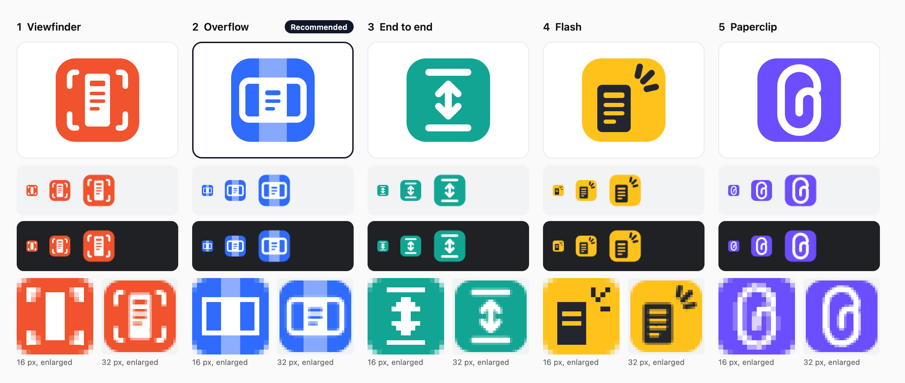

# Icon options

Five directions for the icon. Number 2 is the recommended one. Until one is chosen, the extension uses number 1.

| | What it is meant to say | Strong | Weak |
| --- | --- | --- | --- |
| **1 Viewfinder** | "Take a picture of a page." The corners of a viewfinder around a tall page | Says screenshot at once | Corners like these are a familiar sight on tools of this kind |
| **2 Overflow** (recommended) | "What you cannot see gets captured, too." A page that runs out of the window, above and below; faint outside, solid inside | The only one to show what Clip is for. Independent of the name. Crisp at 16 px | Does not say "picture" at first sight |
| **3 End to end** | "From the top edge to the bottom edge." Nothing but two edges and an arrow | The simplest. Independent of the name | Can be taken for "change the height" |
| **4 Flash** | "Got it." The moment of capture; light from the corner where Clip shows the result | Goes with the flash Clip shows | The rays turn into dots at 16 px |
| **5 Paperclip** | The name, and the clipboard, in one stroke | Name and function in one | Useless if the name changes. Looks like an attachment. Blurred at 16 px |

Every option has a second drawing for 16 px (`-small.svg`), on the pixel grid.

## 日本語

アイコンの 5 案です。推奨は 2 です。決まるまでは、1 を仮に使います。

| | 意図 | 強み | 弱み |
| --- | --- | --- | --- |
| **1 ファインダー** | 「ページを撮る」。縦長のページを、カメラのファインダーの四隅で囲んだ | スクリーンショットだと、すぐ伝わる | 四隅の枠は、この種の道具でよく見る形 |
| **2 はみ出すページ**（推奨） | 「見えていない部分まで撮る」。窓の上下からはみ出すページ。窓の外は薄く、中は濃い | Clip が何のための道具かを表すのは、この案だけ。名前が変わっても使える。16 ピクセルでも鮮明 | 一目で「撮る」とは伝わりにくい |
| **3 端から端まで** | 「ページの上端から下端まで」。2 本の端と矢印だけにした | いちばん単純。名前が変わっても使える | 「高さを変える」の記号に見えることがある |
| **4 閃光** | 「撮れた」。撮れた瞬間の光。光は、Clip が結果を出す右上から出る | 撮ったときに光る演出とつながる | 16 ピクセルでは、光が点に見える |
| **5 クリップ** | 名前とクリップボードを、ひと筆で | 名前と働きが一度に伝わる | 名前が変わると使えない。添付ファイルの記号に見える。16 ピクセルでにじむ |

どの案にも、16 ピクセル用に描き直した絵（`-small.svg`）があります。
